# 🎯 나만의 퀴즈 게임

- Python 기본 문법 및 객체지향 프로그래밍(OOP) 개념을 적용하여 제작한 터미널 기반 퀴즈 게임입니다.
  - 객체지향 프로그래밍(OOP, Object-Oriented Programming)은 프로그래밍의 데이터와 기능을 <br> 클래스(Class)와 객체(Object) 단위로 묶어 역할별로 코드를 구조화하는 프로그래밍 방식입니다

- `JSON` 파일 입출력을 활용한 데이터 영속성 관리와 `Git`을 통한 버전 관리 및 브랜치 협업 흐름을 실습하도록 구성되었습니다.

<br>

---

# 목차

- [1. 프로젝트 개요](#project-overview)
  - [1.1 프로젝트 목적](#project-purpose)
  - [1.2 퀴즈 주제 선정 이유](#quiz-topic)
- [2. 실행 방법](#run-guide)
  - [2.1 개발 환경](#development-environment)
  - [2.2 프로그램 실행](#run-program)
- [3. 기능 목록](#feature-list)
  - [3.1 메인 메뉴](#main-menu)
  - [3.2 퀴즈 풀기](#play-quiz)
  - [3.3 퀴즈 추가](#add-quiz)
  - [3.4 퀴즈 목록 및 삭제](#list-delete-quiz)
  - [3.5 최고 점수 및 기록 히스토리](#score-history)
  - [3.6 입력 검증 및 안전 종료](#input-and-exception)
- [4. 파일 구조](#file-structure)
  - [4.1 폴더 및 파일 트리](#folder-tree)
  - [4.2 주요 파일의 역할](#file-roles)
- [5. 데이터 파일 설명 (state.json)](#data-file)
  - [5.1 state.json 경로와 역할](#state-path)
  - [5.2 state.json 필드 및 스키마](#state-schema)
  - [5.3 예외 처리 및 데이터 복구 (저장·불러오기)](#state-save-load)
- [6. 코드 동작 설명](#code-flow)
  - [6.1 프로그램 시작 흐름](#startup-flow)
  - [6.2 Quiz 클래스](#quiz-class)
  - [6.3 QuizGame 클래스](#quiz-game-class)
  - [6.4 주요 Python 명령어와 문법](#python-syntax)
- [7. Git 워크플로우 및 실습 기록](#git-workflow)
  - [7.1 Git 단계별 커밋](#commit-history)
  - [7.2 브랜치 활용 및 병합 (checkout, merge)](#git-commands)
  - [7.3 브랜치 병합 검증 (git log --oneline --graph)](#git-commands-2)
  - [7.4 Git 저장소 복제 실습 (Clone·Commit·Push·Pull)](#clone-pull-practice)
  - [7.5 Git 7종 핵심 명령어 사용 기록](#git-commands-2)
- [8. 제출용 확인 사항](#submission-checklist)
  - [8.1 실행 및 환경 스크린샷 목록](#screenshots)
- [9. 보너스 과제](#bonus-missions)
  - [9.1 랜덤 출제](#bonus-random)
  - [9.2 문제 수 선택](#bonus-count)
  - [9.3 힌트 기능](#bonus-hint)
  - [9.4 퀴즈 삭제 기능](#bonus-delete)
  - [9.5 점수 기록 히스토리](#bonus-history)

<br><br>

---

<a id="project-overview"></a>
# 1. 프로젝트 개요

| 구분 | 내용 |
| :--- | :--- |
| **프로젝트명** | 파이썬 콘솔 기반 퀴즈 게임 (Console Quiz Game) |
| **최종 결과물 요약** | 터미널 환경에서 실행되는 퀴즈 게임으로 퀴즈 풀기, 퀴즈 추가, 퀴즈 목록 조회, 최고 점수 기록 및 예외 처리 지원 |
| **GitHub 저장소 주소** | [https://github.com/sosohappy79/codyssey_2.git](https://github.com/sosohappy79/codyssey_2.git) |

---

<br>

<a id="project-purpose"></a>
## 1.1 프로젝트 목적

이 프로젝트는 Python 콘솔에서 실행되는 퀴즈 프로그램을 직접 구현하면서 변수, 조건문, 반복문, 함수, 클래스, 파일 입출력, 예외 처리와 Git의 기본 흐름을 연습하기 위한 결과물입니다.

사용자는 메뉴에서 원하는 기능을 선택할 수 있습니다. 퀴즈를 풀거나 직접 새 문제를 등록할 수 있으며, 최고 점수와 이전 게임 기록도 확인할 수 있습니다. 프로그램을 종료한 뒤 다시 실행해도 데이터가 유지되도록 프로젝트 루트의 `state.json` 파일에 저장합니다.

<details>
<summary><b>🔍 [참고] 상세설명 보기 (클릭하여 펼치기)</b></summary>

- **콘솔 프로그램**: 별도의 웹 브라우저나 GUI 없이 터미널에서 글자와 입력으로 사용하는 프로그램입니다.
- **클래스(Class)**: 데이터와 해당 데이터를 처리하는 기능을 하나로 묶는 설계도입니다.
- **데이터 영속성**: 프로그램을 종료해도 데이터를 파일 등에 보관해 다음 실행에서 다시 사용할 수 있는 성질입니다.
- 이 프로젝트는 `Quiz`가 개별 문제를 표현하고, `QuizGame`이 전체 게임 흐름과 저장을 관리하도록 역할을 나눴습니다.
</details>

<br>

<a id="quiz-topic"></a>
## 1.2 퀴즈 주제 선정 이유

- 퀴즈 주제는 **Python 기초 및 프로그래밍 상식**입니다. 
본 프로젝트(퀴즈 게임)를 제작하면서 실제로 사용된 Python의 핵심 기본 문법(`input`, `json`, `try-except`, 클래스 `__init__` 등)과 Git 명령어(`git init`, `commit`, `branch`, `checkout`, `merge` 등)를 직접 복습하고 점검하기 위함입니다.
특히, 개발 실습에 필요한 명령어들을 퀴즈 형태로 풀어보며 실전 감각을 익히고 오랫동안 기억하기 위해 선정했습니다.

---

- 기본 퀴즈는 총 10개이며, 각 문제는 질문 1개, 선택지 4개, 정답 번호 1개, 힌트 1개로 구성됩니다.
  - 문제와 선택지를 함께 확인할 수 있도록 선택지는 1~4번으로 표시합니다.
  - 정답은 선택지의 문장 자체가 아니라 `1`, `2`, `3`, `4`의 정수로 관리합니다.
  - 문제 데이터는 `Quiz` 클래스의 인스턴스로 만듭니다. 따라서 기본 문제와 사용자가 추가한 문제를 같은 방식으로 처리할 수 있습니다.

---

<br><br>

<a id="run-guide"></a>
# 2. 실행 방법

<a id="development-environment"></a>
## 2.1 개발 환경

| 항목 | 사용 환경 |
|---|---|
| 프로그래밍 언어 | Python 3.10 이상 |
| 실행 방식 | 터미널 / 명령 프롬프트 |
| 외부 라이브러리 | 사용하지 않음 |
| 사용한 표준 라이브러리 | `json`, `random`, `datetime`, `pathlib` |
| 데이터 인코딩 | UTF-8 |

<details>
<summary><b>🔍 [참고] 상세설명 보기 (클릭하여 펼치기)</b></summary>

- **표준 라이브러리**는 Python 설치 시 기본으로 제공되는 모듈입니다. 별도의 `pip install`이 필요하지 않습니다.
- `json`은 JSON 파일을 읽고 쓰는 데 사용합니다.
- `random`은 문제 순서를 무작위로 섞는 데 사용합니다.
- `datetime`은 게임 기록의 날짜와 시간을 저장하는 데 사용합니다.
- `pathlib`은 운영체제에 맞는 파일 경로를 다루는 데 사용합니다.
- Python 버전은 아래 명령으로 확인합니다.

  ```bash
  python --version
  ```

</details>

<br>

<a id="run-program"></a>
## 2.2 프로그램 실행

1. 저장소를 내려받거나 프로젝트 폴더를 준비합니다.
2. 터미널에서 `my-quiz-game` 폴더로 이동합니다.
3. 다음 명령어를 실행합니다.

    ```bash
    $ python --version	# python 버전확인 (Python 3.10 이상)
    $ cd my-quiz-game     # 폴더이동
    $ python main.py      # 게임실행
    ```
<br>

4. 실행하면 `main.py`가 `QuizGame` 객체를 만들고 `run()` 메서드를 호출합니다. <br> 사용자가 메뉴에서 7번을 선택하거나 `Ctrl+C`를 입력하면 프로그램이 종료됩니다. 

    | 명령어 | 설명 |
    |---|---|
    | `cd my-quiz-game` | 현재 위치에서 프로젝트 폴더로 이동합니다. `cd`는 change directory의 약자입니다. |
    | `python --version` | 실행 중인 Python 버전을 확인합니다. (Python 3.10 이상) |
    | `python main.py` | Python으로 `main.py` 파일을 실행합니다. |   
 
<br><br>

<a id="feature-list"></a>
# 3. 기능 목록

<a id="main-menu"></a>
## 3.1 메인 메뉴

| 번호 | 기능 | 설명 |
|---:|---|---|
| 1 | 퀴즈 풀기 | 출제할 문제 수를 정하고 무작위 순서로 문제를 풉니다. |
| 2 | 퀴즈 추가 | 문제, 선택지 4개, 정답 번호, 힌트를 등록합니다. |
| 3 | 퀴즈 목록 | 등록된 문제의 번호와 질문을 확인합니다. |
| 4 | 점수 확인 | 최고 점수와 해당 기록의 정답 수를 확인합니다. |
| 5 | 퀴즈 삭제 | 목록에서 선택한 퀴즈를 삭제합니다. |
| 6 | 점수 기록 히스토리 | 지금까지 진행한 게임 기록을 확인합니다. |
| 7 | 종료 | 데이터를 저장하고 프로그램을 종료합니다. |
---

<br>

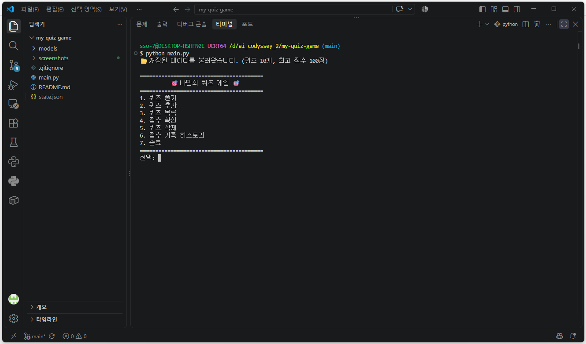


- 프로그램 실행 시 다음 메뉴가 표시됩니다.
  - 메뉴 번호를 입력하면 `_read_menu_choice()`가 입력값을 검사합니다. 
  - 앞뒤 공백을 제거한 뒤 정수로 변환하고, 1~7 범위에 있는 경우에만 선택값으로 반환합니다. 
  - 잘못된 입력은 안내 메시지를 출력하고 다시 입력받습니다.


<br><br>

<a id="play-quiz"></a>

## 3.2 퀴즈 풀기
1. 메인 메뉴에서 `1`을 입력합니다.
2. 풀 문제 수를 입력합니다. 등록된 퀴즈 수보다 큰 수나 0은 입력할 수 없습니다.
3. 문제는 무작위 순서로 표시됩니다.
4. 정답은 `1~4` 중 하나를 입력합니다. 힌트를 보려면 `h`를 입력합니다.
5. 모든 문제를 푼 뒤 정답 수와 최종 점수를 확인합니다.

<br>

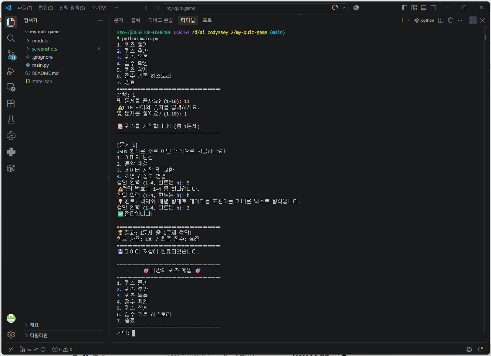


>  <br> 점수 계산 방식은 다음과 같습니다. <br><br>
    - 기본 점수 = 반올림(정답 수 ÷ 푼 문제 수 × 100)  <br>
    - 최종 점수 = 기본 점수 - (힌트 사용 횟수 × 10점) <br>
    - 최종 점수가 0점보다 낮으면 0점으로 처리합니다.
    <br>
    <br>

- `random.shuffle()`은 리스트의 요소 순서를 무작위로 섞습니다. 원본 퀴즈 목록은 유지하기 위해 `self.quizzes.copy()`로 복사한 목록을 섞습니다.
- `input()`은 사용자의 입력을 문자열로 받습니다. 정답 입력값은 `int()`로 정수 변환한 뒤 정답 번호 범위를 확인합니다.
- 힌트는 한 문제에서 한 번만 사용할 수 있습니다. 같은 문제에서 두 번째로 `h`를 입력하면 이미 사용했다는 안내가 나옵니다.
- 예를 들어 5문제 중 4문제를 맞히면 기본 점수는 80점입니다. 힌트를 1회 사용했다면 최종 점수는 70점입니다.

<br><br>

<a id="add-quiz"></a>
## 3.3 퀴즈 추가

1. 메인 메뉴에서 `2`를 선택하면 새로운 퀴즈를 등록합니다. 
2. 질문, 선택지 1~4, 정답 번호, 힌트를 순서대로 입력합니다. 
3. 질문·선택지·힌트는 빈 값으로 등록할 수 없고, 정답 번호는 1~4만 허용합니다.

<br>

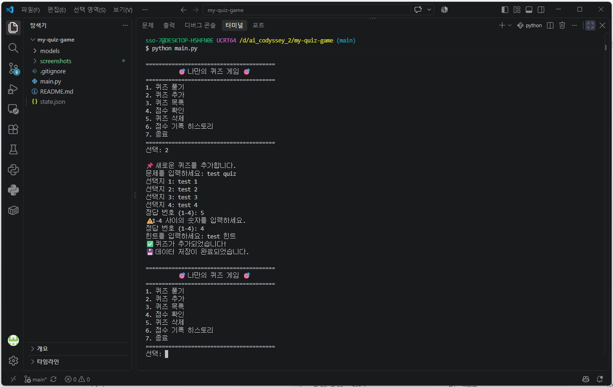

<details>
<summary><b>🔍 [참고] 상세설명 보기 (클릭하여 펼치기)</b></summary>

- `strip()`은 문자열의 앞뒤 공백과 줄바꿈을 제거합니다.
- `_read_non_empty()`는 입력값이 빈 문자열인지 확인하고, 비어 있으면 다시 입력받습니다.
- `_read_number()`는 숫자 변환과 허용 범위 확인을 함께 처리합니다.
- 입력이 모두 유효하면 `Quiz(question, choices, answer, hint)`로 객체를 생성해 퀴즈 목록에 추가합니다.
- 추가 직후 `save_data()`를 호출하므로 정상적으로 저장되면 다음 실행에도 새 문제가 남아 있습니다.
</details>

<br><br>

<a id="list-delete-quiz"></a>
## 3.4 퀴즈 목록 및 삭제

- `enumerate(self.quizzes, start=1)`은 목록의 각 퀴즈에 1부터 시작하는 번호를 붙여 출력합니다.
- `pop(quiz_number - 1)`은 사용자가 입력한 번호와 Python 리스트의 인덱스 차이를 보정해 해당 항목을 삭제합니다. Python 리스트 인덱스는 0부터 시작하기 때문에 1을 빼야 합니다.
- 삭제 확인은 `y` 또는 `n`만 허용합니다. 삭제가 완료되면 즉시 `state.json`에 반영합니다.

---
<br>

**1. 전체 목록 확인**
- 등록되어 있는 모든 Python & Git 명령어 퀴즈의 문제 텍스트 및 번호를 리스트로 출력합니다.
- 메인 메뉴의 `3`번은 현재 등록된 퀴즈의 번호와 질문을 출력합니다.
  <br>

  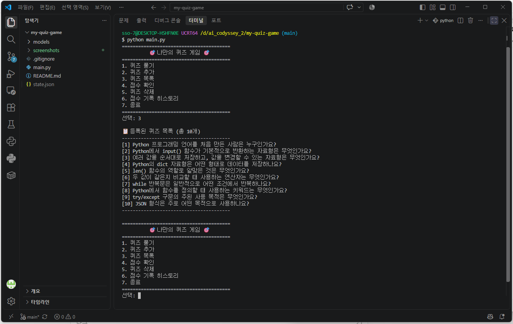

<br>

**2. 퀴즈 삭제하기** 
- `5`번은 삭제할 퀴즈 번호를 입력받아 > 삭제 여부를 한 번 더 확인한 뒤 > 목록에서 제거합니다. 
- 삭제 입력에서 `0`을 선택하면 취소합니다.
  <br>

  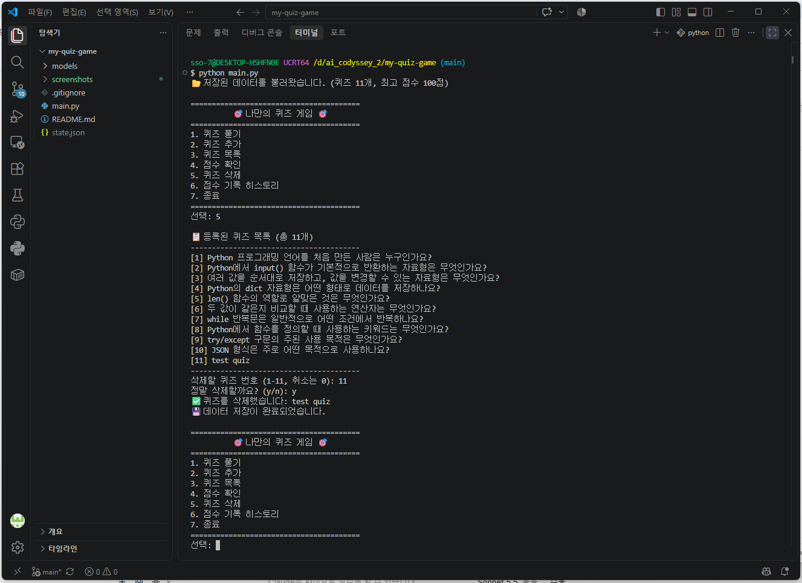

<br><br>

<a id="score-history"></a>
## 3.5 최고 점수 및 기록 히스토리

1. 메인 메뉴의 `4`번에서 최고 점수를 확인하고, `6`번에서 모든 게임 기록을 확인합니다. 
2. 게임이 끝날 때마다 날짜·시간, 푼 문제 수, 정답 수, 힌트 사용 횟수, 최종 점수를 기록합니다. 
3. 현재 점수가 기존 최고 점수보다 높으면 최고 점수를 갱신합니다.

<br>

  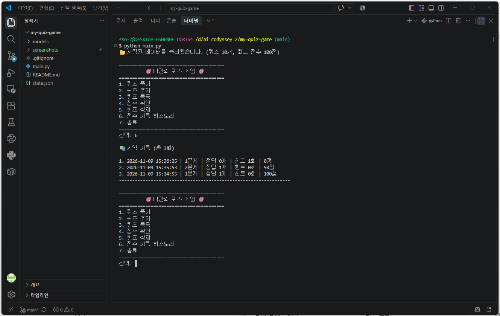

> <br> - 최고 점수 표시: 현재 저장되어 있는 최고 기록 점수 및 정답 개수를 출력합니다. <br> - 풀이 이력 없음 처리: 이전 퀴즈 진행 기록이 없는 경우 관련 문구를 출력합니다. <br>
 <br>

- 게임 기록의 날짜와 시간은 `datetime.now().strftime("%Y-%m-%d %H:%M:%S")` 형식으로 만듭니다.
- `history`는 게임 기록 딕셔너리를 담는 리스트입니다.
- 최고 점수를 아직 획득하지 않았으면 `best_score`는 `None`으로 유지하고, 화면에는 아직 푼 기록이 없다고 표시합니다.
- 히스토리는 최근 기록부터 볼 수 있도록 `reversed(self.history)`로 출력합니다. 원본 저장 순서는 변경되지 않습니다.

<br><br>

<a id="input-and-exception"></a>
## 3.6 입력 검증 및 안전 종료

- 숫자를 입력하는 모든 메뉴와 기능에서 공백, 빈 입력, 문자 입력, 허용 범위를 벗어난 숫자를 검사합니다. 
- `Ctrl+C` 또는 입력 스트림 종료가 발생해도 안내 메시지를 출력하고 저장을 시도한 뒤 종료합니다.
- `try` 블록은 오류가 발생할 수 있는 코드를 실행하고, `except` 블록은 지정한 오류가 발생했을 때 실행할 대응 코드를 담습니다. 
- `finally`는 정상 종료나 예외 상황과 관계없이 마지막 저장을 시도하도록 사용합니다.

  <br>

  | 상황 | 처리 방법 |
  |---|---|
  | ` 1 `처럼 앞뒤 공백이 있는 입력 | `strip()`으로 공백을 제거한 후 처리 |
  | Enter만 입력 | 빈 입력 안내 후 재입력 |
  | `abc`처럼 숫자가 아닌 값 | `int()` 변환 오류를 `ValueError`로 처리 후 재입력 |
  | 메뉴에서 9, 정답에서 0 입력 | 허용 범위 안내 후 재입력 |
  | `Ctrl+C` | `KeyboardInterrupt`를 처리하고 저장 후 종료 |
  | 입력 스트림 종료 | `EOFError`를 처리하고 저장 후 종료 |
  | JSON 파일이 손상됨 | 오류 안내 후 기본 퀴즈와 초기 점수 데이터로 실행 |


  <br>

  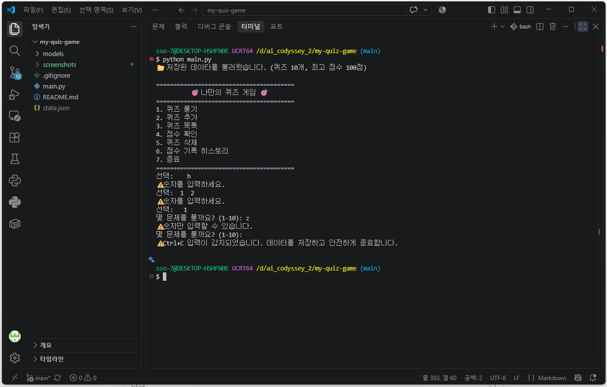


<br><br>

<a id="file-structure"></a>
# 4. 파일 구조

<a id="folder-tree"></a>
## 4.1 폴더 및 파일 트리

```text
my-quiz-game/
├── .gitignore
├── README.md
├── main.py
├── state.json                 # 실행 후 자동 생성, Git 추적 제외
├── models/
│   ├── __init__.py
│   ├── quiz.py
│   └── quiz_game.py
└── screenshots/               # 제출용 스크린샷 저장 위치

```

<br><br>

<a id="file-roles"></a>
## 4.2 주요 파일의 역할

| 파일 | 역할 |
|---|---|
| `main.py` | `QuizGame` 객체를 생성하고 `run()`을 시작합니다. |
| `models/quiz.py` | 질문, 선택지, 정답, 힌트를 가진 `Quiz` 클래스를 정의합니다. |
| `models/quiz_game.py` | 메뉴, 퀴즈 플레이·추가·삭제, 점수, 히스토리, 저장·불러오기를 관리합니다. |
| `models/__init__.py` | `models` 폴더를 Python 패키지로 표시합니다. |
| `.gitignore` | Python 캐시, 가상환경, 실행 중 생성되는 JSON 데이터 등을 Git 추적에서 제외합니다. |
| `README.md` | 프로젝트의 실행 방법과 기능, 구조, 데이터 및 Git 사용법을 설명합니다. |

> <br> - `main.py`에는 게임의 세부 기능을 작성하지 않습니다. <br> 실행 진입점만 남겨 두면 실제 기능이 바뀌어도 시작 코드는 간단하게 유지할 수 있습니다. 세부 기능은 `Quiz`와 `QuizGame`의 메서드로 분리했습니다. <br>
    - `models/`에는 퀴즈 데이터 모델과 게임 진행 로직을 둡니다. <br>
    - `state.json`은 프로그램에서 생성하는 데이터 파일입니다. 첫 실행 전에는 파일이 없을 수 있습니다. <br>
    - `.gitignore`에 `state.json`을 등록해 개인 실행 데이터가 Git 커밋에 포함되지 않도록 했습니다. <br>
    <br>


<br><br>

<a id="data-file"></a>
# 5. 데이터 파일 설명 (`state.json`)

<a id="state-path"></a>
## 5.1 state.json 경로와 역할

- **파일 경로**: `./state.json` (프로젝트 루트 디렉터리)
- **저장 방식**: UTF-8 인코딩 기반 JSON 형식
- **주요 역할**: 퀴즈 게임의 추가 데이터 및 최고 점수, 실행 히스토리를 저장하여 프로그램 재시작 시에도 데이터가 보존되는 데이터 영속성을 제공합니다.

  🔍 [참고] 추가 설명
  - 데이터 파일은 프로젝트 최상위 폴더의 `state.json`에 위치합니다. `models/quiz_game.py`의 위치를 기준으로 상위 프로젝트 폴더를 찾아 파일 경로를 동적으로 구성하므로, 터미널의 현재 작업 위치와 관계없이 항상 프로젝트 루트에 데이터가 저장됩니다.
  - `Path(__file__).resolve()`로 현재 파일의 절대 경로를 구한 뒤, `.parent.parent`를 이용해 `models` 폴더의 상위 디렉터리인 프로젝트 루트 경로를 탐색합니다.
  - 첫 실행 시 파일이 없으면 기본 퀴즈 10개로 시작합니다. 퀴즈 추가/삭제 및 게임 종료 시 자동으로 데이터를 저장합니다.
  - `state.json`은 프로그램 실행에 따라 상태가 지속적으로 변경되므로 `.gitignore`에 등록하여 소스 코드와 사용자 데이터 파일을 분리 관리합니다.

<br><br>

<a id="state-schema"></a>
## 5.2 state.json 필드 및 스키마

`state.json` 데이터는 아래 구조를 사용합니다.  
*(※ 아래 예시는 스키마 설명용이며, 실제 파일에는 기본 퀴즈와 사용자가 추가한 퀴즈 목록이 함께 저장됩니다.)*

```json
{
    "schema_version": 1,
    "quizzes": [
        {
            "question": "Python에서 함수를 정의할 때 사용하는 키워드는?",
            "choices": ["def", "class", "return", "import"],
            "answer": 1,
            "hint": "함수 정의의 시작에 사용하는 키워드입니다."
        }
    ],
    "best_score": 100,
    "best_correct": 1,
    "best_total": 1,
    "history": [
        {
            "date": "2026-11-09 14:00:00",
            "question_count": 1,
            "correct_count": 1,
            "hint_count": 0,
            "score": 100
        }
    ]
}
```

| 필드명 | 자료형 | 설명 |
| :--- | :--- | :--- |
| `schema_version` | 정수 | 데이터 구조 버전 (현재 버전: `1`) |
| `quizzes` | 리스트 | 등록된 퀴즈 객체 목록 (`list[dict]`) |
| `quizzes[].question` | 문자열 | 퀴즈 문제 문구 |
| `quizzes[].choices` | 리스트 | 4개의 선택지 문구 리스트 (`list[str]`) |
| `quizzes[].answer` | 정수 | 정답 선택지 번호 (1~4) |
| `quizzes[].hint` | 문자열 | 해당 문제의 힌트 문구 |
| `best_score` | 정수 \| null | 역대 최고 점수 (0~100, 미기록 시 `null`) |
| `best_correct` | 정수 | 최고 점수 달성 시 정답 맞힌 문제 수 |
| `best_total` | 정수 | 최고 점수 달성 시 풀었던 전체 문제 수 |
| `history` | 리스트 | 전체 게임 플레이 기록 목록 (시간순) |
| `history[].date` | 문자열 | 게임 완료 날짜 및 시간 (`YYYY-MM-DD HH:MM:SS`) |
| `history[].question_count` | 정수 | 해당 판에서 푼 전체 문제 수 |
| `history[].correct_count` | 정수 | 해당 판의 정답 맞힌 개수 |
| `history[].hint_count` | 정수 | 해당 판의 힌트 사용 횟수 |
| `history[].score` | 정수 | 힌트 감점이 반영된 최종 점수 |

- **JSON 객체**는 중괄호 `{}`로 표현하며, 키와 값으로 구성됩니다.
- **JSON 배열**은 대괄호 `[]`로 표현합니다. Python에서는 리스트로 읽습니다.
- **null**은 값이 없음을 뜻합니다. Python의 `None`과 대응합니다.
- `ensure_ascii=False` 옵션을 사용해 한글이 `\u` 형태로 바뀌지 않고 읽기 쉬운 UTF-8 문자로 저장되도록 했습니다.


<br><br>

<a id="state-save-load"></a>
## 5.3 예외 처리 및 데이터 복구 (저장·불러오기)

- 데이터 로드 (load_data): 프로그램 시작 시 JSON 파일을 읽고 Quiz 객체 리스트 및 최고 점수 상태로 변환합니다.
- 안전한 저장 (save_data / Atomic Write): 저장 도중 프로그램이 강제 종료되어 데이터 파일이 손상되는 것을 방지하기 위해, 임시 파일(state.json.tmp)에 먼저 기록한 후 Path.replace()를 통해 state.json으로 교체합니다. <br>
- 예외 처리 및 자동 복구:
  - 파일 미존재, JSON 포맷 손상(JSONDecodeError), 필수 필드/타입 오류(ValueError, KeyError)가 발생할 경우 감지 안내 메시지를 출력합니다.
  - 프로그램이 강제 종료되지 않도록 기본 퀴즈 10개 및 초기 점수 상태로 자동 복구하여 실행됩니다.
  - 복구된 정상 데이터는 이후 게임 진행 시 새로 저장되어 정상 파일로 갱신됩니다.

  <br>

  | 코드 / 명령 | 역할 |
  |---|---|
  | `open("r", encoding="utf-8")` | UTF-8 텍스트 파일 안전 읽기 |
  | `json.load(file)` | SON 문자열을 파이썬 객체(dict, list)로 파싱 |
  | `json.dump(data, file, ensure_ascii=False, indent=4)` | 파이썬 객체를 들여쓰기 적용된 UTF-8 JSON 파일로 저장 |
  | `Path.replace()` | 임시 파일(state.json.tmp)을 원본 state.json으로 원자적(Atomic) 교체 |
  | `try/except` | 파일 접근 권한, 입출력 에러, 데이터 깨짐 등 예외 상황 방어 |


<br><br>

<a id="code-flow"></a>
# 6. 코드 동작 설명

<a id="startup-flow"></a>
## 6.1 프로그램 시작 흐름

프로그램의 실행 순서는 다음과 같습니다.

1. 사용자가 `python main.py`를 실행합니다.
2. `main.py`에서 `QuizGame()` 객체를 생성합니다.
3. `game.run()`이 실행됩니다.
4. `load_data()`가 `state.json`을 불러오거나 기본 데이터를 준비합니다.
5. 메뉴를 표시하고 입력값에 맞는 메서드를 실행합니다.
6. 사용자가 종료하거나 입력이 중단되면 `finally`에서 저장을 시도합니다.

<details>
<summary><b>🔍 [참고] 상세설명 보기 (클릭하여 펼치기)</summary>

`if __name__ == "__main__":`은 해당 파일을 직접 실행했을 때만 `main()`을 호출하도록 하는 Python 실행 조건입니다. 다른 Python 파일에서 `main.py`를 가져오는 경우에는 자동으로 게임이 시작되지 않습니다.
</details>

<br><br>

<a id="quiz-class"></a>
## 6.2 Quiz 클래스

`Quiz` 클래스는 퀴즈 한 문제를 표현합니다.

| 속성 / 메서드 | 설명 |
|---|---|
| `question` | 문제 문장 |
| `choices` | 4개 선택지 리스트 |
| `answer` | 정답 번호(1~4) |
| `hint` | 힌트 문장 |
| `display(number)` | 문제와 선택지를 출력합니다. |
| `is_correct(user_answer)` | 입력한 답이 정답인지 비교해 `True` 또는 `False`를 반환합니다. |
| `to_dict()` | 퀴즈 객체를 JSON 저장에 적합한 딕셔너리로 변환합니다. |
| `from_dict(data)` | 딕셔너리 데이터로부터 퀴즈 객체를 생성합니다. |

<details>
<summary><b>🔍 [참고] 상세설명 보기 (클릭하여 펼치기)</summary>

- `__init__()`은 객체를 만들 때 자동으로 실행되는 초기화 메서드입니다.
- `self`는 현재 만들어진 객체 자신을 가리킵니다. `self.question`처럼 작성하면 객체마다 다른 문제 데이터를 가질 수 있습니다.
- **속성(attribute)**은 객체가 보관하는 데이터이고, **메서드(method)**는 객체가 수행하는 기능입니다.
- `is_correct()`는 정답 여부를 `True` 또는 `False`라는 논리 자료형으로 돌려줍니다.
</details>

<br><br>

<a id="quiz-game-class"></a>
## 6.3 QuizGame 클래스

`QuizGame` 클래스는 프로그램의 전체 흐름을 관리합니다. 메뉴 입력, 퀴즈 출제, 등록·삭제, 점수 계산, 게임 기록, JSON 저장·불러오기 기능을 메서드로 나눠 구현했습니다.

| 메서드 | 역할 |
|---|---|
| `_show_menu()` | 메인 메뉴 출력 |
| `_read_menu_choice()` | 메뉴 번호 입력 검증 |
| `_read_number()` | 숫자와 허용 범위 검증 |
| `_read_non_empty()` | 빈 문자열 입력 방지 |
| `_read_answer()` | 정답 및 힌트 입력 처리 |
| `play_quiz()` | 문제 섞기, 문제 수 선택, 출제, 채점 |
| `add_quiz()` | 새 퀴즈 등록 |
| `show_quizzes()` | 퀴즈 목록 출력 |
| `delete_quiz()` | 퀴즈 삭제 및 저장 |
| `show_best_score()` | 최고 점수 출력 |
| `show_history()` | 전체 게임 기록 출력 |
| `load_data()` | JSON 데이터 불러오기 및 검증 |
| `save_data()` | JSON 데이터 저장 |
| `_handle_menu_choice()` | 메뉴 번호에 해당하는 기능 실행 |
| `run()` | 게임 시작, 반복 실행, 안전 종료 |

<details>
<summary><b>🔍 [참고] 상세설명 보기 (클릭하여 펼치기)</summary>

메서드 이름 앞의 `_`는 클래스 내부에서 주로 사용하는 보조 메서드라는 의미로 붙였습니다. Python에서 접근 자체를 강제로 막는 표시는 아니지만, 외부에서 직접 호출하기보다 클래스 내부 흐름에서 사용한다는 관례를 나타냅니다.
</details>

<br><br>

<a id="python-syntax"></a>
## 6.4 주요 Python 명령어와 문법

| 문법 / 명령어 | 이 프로젝트에서의 사용 | 설명 |
|---|---|---|
| `import` | `import json`, `import random` | 모듈을 가져옵니다. |
| `class` | `class Quiz`, `class QuizGame` | 클래스를 정의합니다. |
| `def` | `def play_quiz(self)` | 함수를 정의합니다. 클래스 안에 정의한 함수는 메서드입니다. |
| `input()` | 메뉴·문제·정답 입력 | 사용자 입력을 문자열로 받습니다. |
| `print()` | 메뉴와 결과 출력 | 터미널에 내용을 출력합니다. |
| `strip()` | 입력값 앞뒤 공백 제거 | 문자열의 양 끝 공백을 제거합니다. |
| `int()` | 숫자 입력 변환 | 문자열을 정수로 변환합니다. 변환할 수 없으면 `ValueError`가 발생합니다. |
| `if / elif / else` | 메뉴 분기와 정답 판정 | 조건에 따라 실행할 코드를 선택합니다. |
| `for` | 퀴즈 목록과 선택지 출력 | 반복 가능한 항목을 하나씩 처리합니다. |
| `while` | 메뉴와 재입력 반복 | 조건이 참인 동안 반복합니다. |
| `try / except / finally` | 입력·파일 오류 처리와 종료 저장 | 예외 대응과 마지막 정리 작업을 수행합니다. |
| `return` | 입력 결과·정답 여부 반환 | 메서드 실행 결과를 호출한 곳으로 돌려줍니다. |
| `random.shuffle()` | 출제 순서 무작위 변경 | 리스트의 순서를 섞습니다. |
| `json.load()` / `json.dump()` | JSON 파일 입출력 | JSON과 Python 자료형 사이의 변환을 처리합니다. |

<details>
<summary><b>🔍 [참고] 상세설명 보기 (클릭하여 펼치기)</summary>

초보자가 자주 혼동하는 자료형은 다음과 같습니다.

| 자료형 | 예시 | 설명 |
|---|---|---|
| `int` | `10` | 정수 |
| `str` | `"Python"` | 문자열 |
| `bool` | `True`, `False` | 참 또는 거짓 |
| `list` | `[1, 2, 3]` | 순서가 있고 수정 가능한 목록 |
| `dict` | `{"name": "Python"}` | 키와 값으로 구성된 데이터 |

`for`는 목록의 각 요소를 순서대로 처리할 때 적합하고, `while`은 메뉴처럼 사용자가 종료를 선택할 때까지 반복해야 하는 상황에 적합합니다.
</details>

<br><br>

<a id="git-workflow"></a>
# 7. Git 워크플로우 및 실습 기록

<a id="commit-history"></a>
## 7.1 Git 단계별 커밋

기능 단위로 아래 커밋을 구성했습니다. 퀴즈 풀기 기능은 `feature/quiz-play` 브랜치에서 작업하고 `main`으로 병합했습니다. <br>
5번 작업은 별도 브랜치에서 커밋한 뒤 `main`에 병합했습니다. 병합 커밋은 작업 흐름을 그래프에서 확인할 수 있도록 `--no-ff` 옵션으로 만들었습니다.

| 순서 | 커밋 메시지 |
|---:|---|
| 1 | `Chore: 프로젝트 초기 설정 (.gitignore 및 README 생성)` |
| 2 | `Feat: 메인 메뉴 출력 및 선택 기능 구현` |
| 3 | `Feat: Quiz 클래스 정의 및 메서드 구현` |
| 4 | `Feat: 기본 퀴즈 데이터 10개 작성` |
| 5 | `Feat: 퀴즈 풀기 기능 및 정답 판정 로직 구현(브랜치 활용)` |
| 6 | `Feat: 퀴즈 추가 기능 및 입력 검증 로직 구현` |
| 7 | `Feat: 퀴즈 목록 조회 기능 구현` |
| 8 | `Feat: 최고 점수 확인 및 갱신 로직 구현` |
| 9 | `Refactor: QuizGame 클래스로 전체 게임 관리 로직 분리` |
| 10 | `Feat: state.json 저장/불러오기 및 예외 처리 구현` |
| 11 | `Docs: README 상세 문서 작성` |

> <br>커밋(commit)은 특정 시점의 변경 사항을 저장소 이력으로 기록하는 단위입니다. <br>
> `Feat`는 기능 추가, `Chore`는 초기 설정 등 준비 작업, `Refactor`는 외부 동작을 유지하면서 코드 구조를 개선하는 작업, `Docs`는 문서 변경을 나타냅니다. <br><br>

<br>

- GitHub Commits

  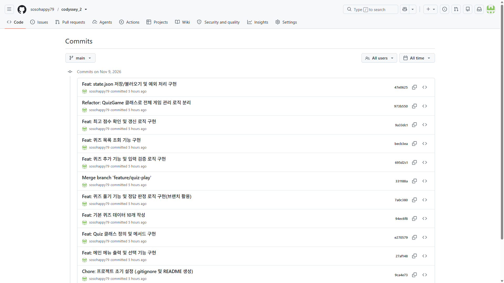 

<br><br>

<a id="git-commands"></a>
## 7.2 브랜치 활용 및 병합 (checkout, merge)

퀴즈 풀기 기능 개발 시 `feature/quiz-play` 브랜치를 생성하여 메인 코드와 독립적으로 개발을 진행한 후, 개발 완료 시점에 `main` 브랜치로 성공적으로 병합했습니다.

```bash
# 1. 퀴즈 풀기 전용 브랜치 생성 및 이동
git checkout -b feature/quiz-play

# 2. 풀기 기능 개발 완료 후 커밋
git add .
git commit -m "Feat: 퀴즈 풀기 기능 및 정답 판정 로직 구현(브랜치 활용)"

# 3. main 브랜치 이동 및 병합
git checkout main
git merge feature/quiz-play

# 4. 병합된 main 브랜치를 원격 저장소에 동기화
git push origin main
```

<br><br>

<a id="git-commands-2"></a>
## 7.3 브랜치 병합 검증 (git log --oneline --graph)

터미널에서 git log --oneline --graph 명령어를 실행하여 feature/quiz-play 브랜치가 독립적으로 생성되어 작업된 후 main 브랜치로 정상적으로 병합되었음을 확인했습니다.

```bash
$ git log --oneline --graph
* 6208a5b (HEAD -> main, origin/main) Docs: clone 실습 테스트 문구 추가
* 47e0625 Feat: state.json 저장/불러오기 및 예외 처리 구현
* 973b550 Refactor: QuizGame 클래스로 전체 게임 관리 로직 분리
* 9a33dc1 Feat: 최고 점수 확인 및 갱신 로직 구현
* becb3ea Feat: 퀴즈 목록 조회 기능 구현
* 695d2c1 Feat: 퀴즈 추가 기능 및 입력 검증 로직 구현
*   331188a Merge branch 'feature/quiz-play'
|\  
| * 7a0c380 (feature/quiz-play) Feat: 퀴즈 풀기 기능 및 정답 판정 로직 구현(브랜치 활용)
|/  
* 94ec6f8 Feat: 기본 퀴즈 데이터 10개 작성
* e270579 Feat: Quiz 클래스 정의 및 메서드 구현
* 27af148 Feat: 메인 메뉴 출력 및 선택 기능 구현
* 9ca4e73 Chore: 프로젝트 초기 설정 (.gitignore 및 README 생성)
```
> 병합 포인트 확인 : <br> 331188a Merge branch 'feature/quiz-play' 병합 커밋을 통해 <br> feature/quiz-play 브랜치에서 작업한 내역(7a0c380)이 main 브랜치에 정상 통합되었음을 검증했습니다.

<br>
- git log --oneline --graph 실행 결과 스크린샷

<br>

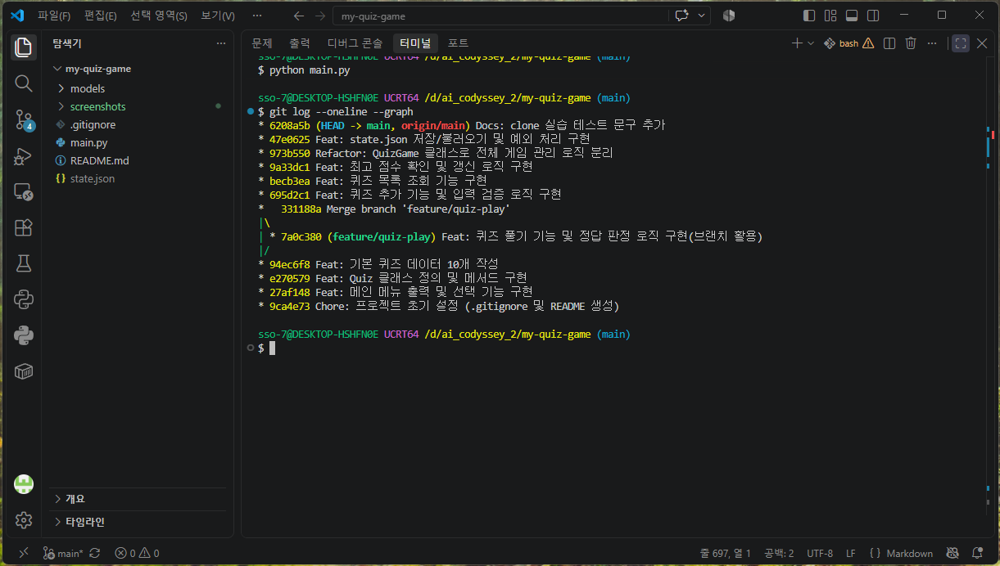

<br><br>

<a id="clone-pull-practice"></a>
## 7.4 Git 저장소 복제 실습 (Clone·Commit·Push·Pull)

복제 저장소 변경 실습은 다음 순서로 진행합니다. 먼저 `my-quiz-game` 저장소를 GitHub에 push한 뒤 진행해야 합니다.
1. git clone : clone(복제)을 먼저 실행해야 내 컴퓨터에 '복제된 저장소(폴더)'가 만들어집니다.
2. 복제본 폴더에서 commit → push : 생성된 복제 폴더(test_folder)로 이동한 뒤 README.md 등에 내용을 수정하고, 이 변경사항을 GitHub 원격 저장소로 올려야 합니다.
3. 원래 저장소 폴더로 돌아와 git pull : 원격 저장소에 새로 push된 최신 변경내역을 원래 내가 작업하던 저장소(codyssey_2)로 당겨와 동기화합니다.

<br>

- clone → commit
  ```bash
  # 원래 프로젝트 폴더의 상위 폴더로 이동
  $ cd ..

  # GitHub 저장소를 별도 폴더에 복제
  $ git clone https://github.com/sosohappy79/codyssey_2.git test_folder

  [출력값]
  Cloning into 'test_folder'...
  remote: Enumerating objects: 45, done.
  remote: Counting objects: 100% (45/45), done.
  remote: Compressing objects: 100% (19/19), done.
  remote: Total 45 (delta 26), reused 45 (delta 26), pack-reused 0 (from 0)
  Receiving objects: 100% (45/45), 10.62 KiB | 3.54 MiB/s, done.
  Resolving deltas: 100% (26/26), done.

  ```

  ```bash
  # 복제한 폴더로 이동
  $ cd test_folder

  # README.md에 한 줄을 직접 추가한 뒤 저장
  # 변경 내용을 확인하고 커밋 및 push
  $ git status
  $ git add README.md
  $ git commit -m "Docs: clone 실습 테스트 문구 추가"

  [출력값]
  [main 6208a5b] Docs: clone 실습 테스트 문구 추가
  1 file changed, 3 insertions(+)

  ```
  <br>

- commit → push → pull
  ```bash
  $ git push origin main

  [출력값]
  Enumerating objects: 5, done.
  Counting objects: 100% (5/5), done.
  Delta compression using up to 12 threads
  Compressing objects: 100% (3/3), done.
  Writing objects: 100% (3/3), 380 bytes | 380.00 KiB/s, done.
  Total 3 (delta 2), reused 0 (delta 0), pack-reused 0 (from 0)
  remote: Resolving deltas: 100% (2/2), completed with 2 local objects.
  To https://github.com/sosohappy79/codyssey_2.git
    47e0625..6208a5b  main -> main

  # 기존 작업 폴더로 이동해 원격 변경 사항을 pull
  $ cd ../my-quiz-game
  $ git pull origin main
  ```

  <details>
  <summary><b>🔍 [참고] 상세설명 보기 (클릭하여 펼치기)</summary>

  일반적인 작업 순서는 다음과 같습니다.

  ```bash
  git status
  git add .
  git commit -m "Feat: 작업 내용 설명"
  git push origin main
  ```

  1. `git status`로 수정된 파일을 확인합니다.
  2. `git add .`로 현재 폴더의 변경 사항을 커밋 준비 영역에 올립니다.
  3. `git commit -m`으로 변경 내용을 기록합니다. `-m` 뒤의 문자열은 커밋 메시지입니다.
  4. `git push`로 원격 저장소에 업로드합니다.

  ---
  <br>

  | 순서 | 명령어 | 실행 결과 |
  |---:|---|---|
  | 1 | `git clone 저장소주소 폴더명` | GitHub의 저장소 전체와 커밋 이력을 새 폴더로 복제합니다. |
  | 2 | `git add README.md` | 수정한 README 파일을 커밋 대상으로 지정합니다. |
  | 3 | `git commit -m "Docs: ..."` | 복제된 저장소에서 변경 사항을 새 커밋으로 남깁니다. |
  | 4 | `git push origin main` | 복제된 저장소에서 만든 커밋을 GitHub에 올립니다. |
  | 5 | `git pull origin main` | 원래 작업 폴더가 GitHub에 올라간 새 커밋을 가져옵니다. |

  - `origin`은 원격 저장소를 가리키는 기본 별칭입니다.
  - `main`은 가져오거나 업로드할 브랜치 이름입니다.
  - 원격 저장소의 기본 브랜치가 `main`이 아니라면 실제 브랜치 이름을 명령어에 사용해야 합니다.
  </details>

<br><br>

<a id="git-commands-2"></a>
## 7.5 Git 7종 핵심 명령어 사용 기록

| 명령어 | 사용 목적 및 실습 내용 |
| --- | --- |
| **`git init`** | 내 컴퓨터에 새 프로젝트 폴더를 만들고 Git 저장소 초기화 |
| **`git add`** | 소스 코드 및 문서 파일을 커밋 대기 상태(Staging)로 등록 |
| **`git commit`** | 단위별 개발 이력을 커밋 메시지와 함께 기록 |
| **`git push`** | 로컬 커밋 내역을 GitHub 원격 저장소에 전송 |
| **`git pull`** | 원격 저장소의 최신 이력을 로컬 저장소로 다운로드 및 병합 |
| **`git checkout`** | 작업 브랜치(`feature/quiz-play`) 생성 및 전환 |
| **`git clone`** | 완성된 저장소를 복제하여 clone/pull 실습 환경 구성 |


<details>
<summary><b>🔍 [참고] Git 기본 명령어 예시문 보기 (클릭하여 펼치기)</summary>
<br>

- Git 기본 명령어

  | 명령어 | 예시 | 설명 |
  |---|---|---|
  | `git init` | `git init -b main` | 현재 폴더에 Git 저장소를 초기화합니다. |
  | `git add` | `git add README.md` | 지정한 파일의 변경 사항을 다음 커밋에 포함하도록 준비합니다. |
  | `git commit` | `git commit -m "Feat: 기능 구현"` | 준비된 변경 사항을 커밋으로 기록합니다. |
  | `git push` | `git push -u origin main` | 로컬 브랜치의 커밋을 원격 저장소로 전송합니다. |
  | `git pull` | `git pull origin main` | 원격 저장소의 변경 사항을 가져와 현재 브랜치에 반영합니다. |
  | `git checkout` | `git checkout -b feature/quiz-play` | 브랜치를 만들거나 다른 브랜치로 이동합니다. |
  | `git clone` | `git clone 저장소주소` | 원격 저장소를 새 폴더에 복제합니다. |
  | `git merge` | `git merge --no-ff feature/quiz-play` | 다른 브랜치의 변경 사항을 현재 브랜치에 병합합니다. |

</details>

<br><br>


<a id="submission-checklist"></a>
# 8. 제출용 확인 사항

<a id="screenshots"></a>
## 8.1 실행 및 환경 스크린샷 목록

실제 개발 환경에서 캡처하여 `my-quiz-game\screenshots` 폴더에 저장되었습니다.

| 파일명 | 캡처 내용 |
|---|---|
| `VScode.png` | VS Code 개발 환경 |
| `python_version.png` | Python 버전 |
| `git_setting.png` | Git 설정 |
| `game_menu.png` | 프로그램 메인 메뉴 |
| `game_play.png` | 퀴즈 풀기와 최종 결과 (숫자오류/힌트보기 포함) |
| `game_add_quiz.png` | 퀴즈 추가 과정 |
| `game_quiz_list.png` | 등록된 퀴즈 목록 |
| `game_score.png` | 최고 점수 또는 게임 기록 |
| `game_quiz_list_delete.png` | 퀴즈 삭제하기 |
| `game_save.png` | 입력 검증 및 안전 종료 |
| `git_branch.png` | `git log --oneline --graph` 실행 결과 (브랜치 활용) |
| `bonus_random_quiz.png` | 보너스과제 / 랜덤 출제 : <br> 퀴즈 시작 시 원본 순서와 달리 무작위(Random)로 섞여 출제되는 1번 문제 터미널 화면 |
| `bonus_question_count.png` | 보너스과제 / 문제 수 선택 : <br> 퀴즈 풀기 전 "풀 문제 수를 입력하세요" 프롬프트에 문제 수 입력 및 선택된 개수만큼 출제되는 화면 |
| `bonus_hint_system.png` | 보너스과제 / 힌트 기능 : <br> 문제 풀이 중 `h` 입력 시 힌트 문구 출력 및 게임 종료 후 힌트 감점(-10점)이 반영된 최종 점수 화면 |
| `bonus_quiz_delete.png` | 보너스과제 / 퀴즈 삭제 기능 : <br> 5번 메뉴(퀴즈 삭제) 진입 후 삭제할 번호 선택, 삭제 재확인(`y/n`) 및 성공 메시지 출력 화면 |
| `bonus_play_history.png` | 보너스과제 / 점수 기록 히스토리 : <br> 6번 메뉴(게임 기록 조회) 진입 후 플레이 날짜/시간, 문제 수, 정답 수, 힌트 횟수, 최종 점수가 최신순 목록으로 출력된 화면 |
|  |  |

<br><br>

<a id="bonus-missions"></a>
# 9. 보너스 과제

| 보너스 과제 항목 | 내용 설명 |
|---|---|
| 9.1 랜덤 출제 | 랜덤으로 퀴즈 순서가 섞여 출제되는 터미널 화면 |
| 9.2 문제 수 선택 | 풀 문제 수를 직접 지정하고 입력하는 터미널 화면 |
| 9.3 힌트 기능 | `h` 입력 시 힌트 표시 및 점수 감점 적용 화면 |
| 9.4 퀴즈 삭제 기능 | 5번 메뉴에서 등록된 퀴즈를 삭제 처리하는 화면 |
| 9.5 점수 기록 히스토리 | 6번 메뉴에서 누적 실행 히스토리를 최신순 조회하는 화면 |
|  |  |

<a id="bonus-random"></a>
## 9.1 랜덤 출제
- **기능 개요**: 퀴즈를 시작할 때 원본 데이터를 유지한 채 문제 순서를 무작위로 섞어 출제합니다 .
- **주요 특징**: 반복 플레이 시에도 매번 다른 문제 순서로 출제되어 게임의 몰입도와 학습 효과를 높입니다 .

<br>

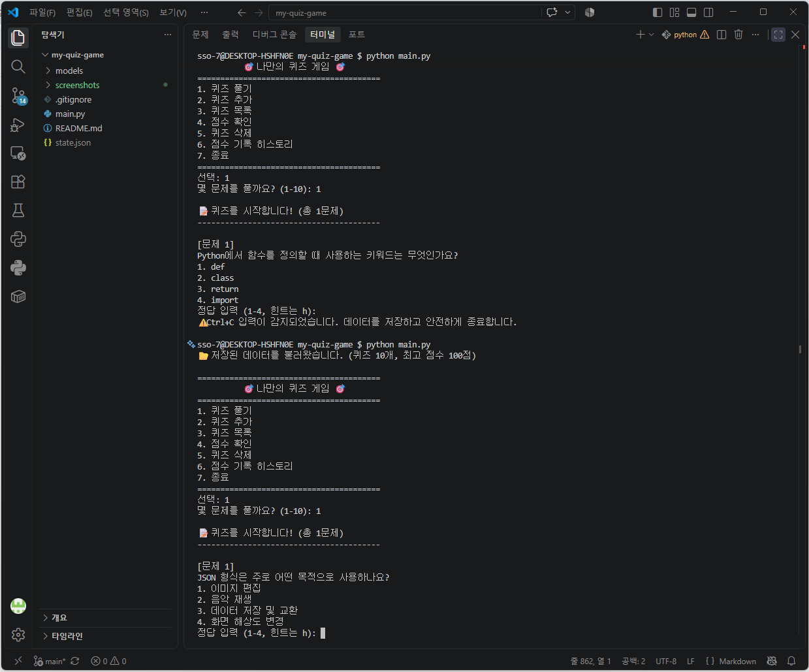

- 퀴즈를 시작할 때 퀴즈 목록을 복사하고 `random.shuffle()`로 순서를 섞습니다. 게임을 여러 번 실행하면 출제 순서가 달라질 수 있습니다.
  - `import random`으로 표준 라이브러리의 random 모듈을 가져옵니다. `random.shuffle(quiz_pool)`은 전달한 리스트 자체의 순서를 변경합니다. 원본 `self.quizzes`의 등록 순서는 유지하도록 복사본을 섞습니다.

    <details>
    <summary><b>🔍 [참고] 상세설명 보기 (클릭하여 펼치기)</summary>

    - **원형 데이터 보호**: 원본 퀴즈 리스트(`self.quizzes`)의 순서 훼손을 방지하기 위해 `self.quizzes.copy()`로 얕은 복사본(`quiz_pool`)을 생성 후 작업을 진행합니다.
    - **무작위 셔플**: Python 파이썬 표준 라이브러리인 `random.shuffle(quiz_pool)` 함수를 호출하여 퀴즈 객체들의 인덱스 순서를 무작위로 재배치합니다.
    - **데이터 영속성 영향 없음**: 셔플은 메모리 상의 플레이용 리스트에서만 수행되므로 `state.json` 데이터 파일의 원본 저장 순서에는 영향을 주지 않습니다.

    </details>

<br><br>

<a id="bonus-count"></a>
## 9.2 문제 수 선택

- **기능 개요**: 퀴즈 시작 전 플레이어가 풀고 싶은 문제 수를 직접 지정합니다.
- **주요 특징**: 등록된 전체 퀴즈 수 이하 범위 내에서 1개부터 자유롭게 입력받아 무작위로 선택된 문제만 출제합니다.

<br>

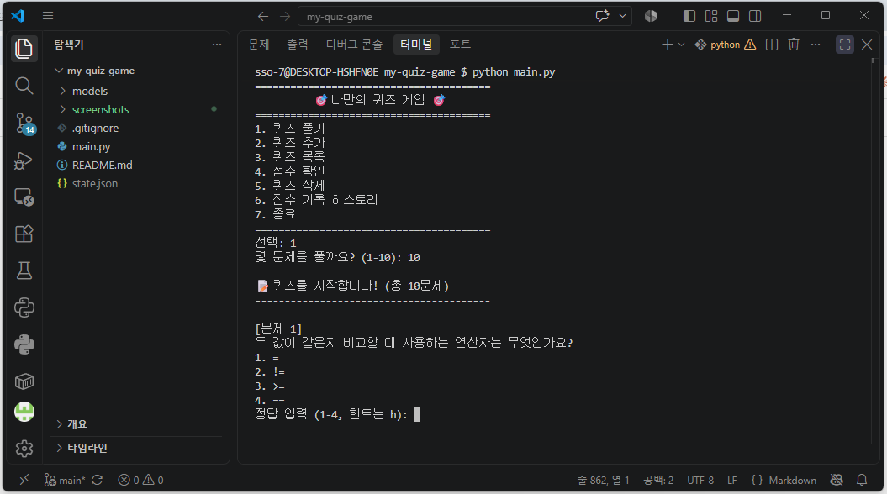

- 퀴즈 시작 전에 풀 문제 수를 선택합니다. 입력 범위는 1개부터 현재 등록된 퀴즈 수까지입니다. 섞인 목록에서 선택한 개수만큼 잘라 출제합니다.
  - `_read_number()`가 문제 수를 정수로 변환하고 범위를 검사합니다. `quiz_pool[:question_count]`는 리스트의 처음부터 선택한 개수만큼의 요소를 가져오는 슬라이싱 문법입니다.

    <details>
    <summary><b>🔍 [참고] 상세설명 보기 (클릭하여 펼치기)</summary>

    - **범위 유효성 검증**: `_read_number()` 공통 유틸리티 메서드를 활용하여 `1`부터 `len(quiz_pool)` 사이의 정수만 받도록 엄격하게 제어합니다.
    - **리스트 슬라이싱**: 셔플이 완료된 무작위 퀴즈 목록에서 사용자가 입력한 개수만큼 슬라이싱(`quiz_pool[:question_count]`)하여 추출합니다.
    - **입력 예외 처리**: 숫자가 아닌 문자 입력, 공백(Enter), 0 또는 전체 퀴즈 수를 초과하는 수 입력 시 경고 메시지를 출력하고 재입력 루프로 안전하게 복귀합니다.

    </details>

<br><br>

<a id="bonus-hint"></a>
## 9.3 힌트 기능

- **기능 개요**: 개별 문제 풀이 중 `h`를 입력하여 힌트를 제공받을 수 있으며, 힌트 사용 횟수에 따라 최종 점수에서 감점 처리됩니다.
- **주요 특징**: 난이도가 높거나 헷갈리는 문제의 힌트를 얻는 대신 감점 요소가 적용되어 게임적 재미와 전략적 선택 요소를 제공합니다.

<br>

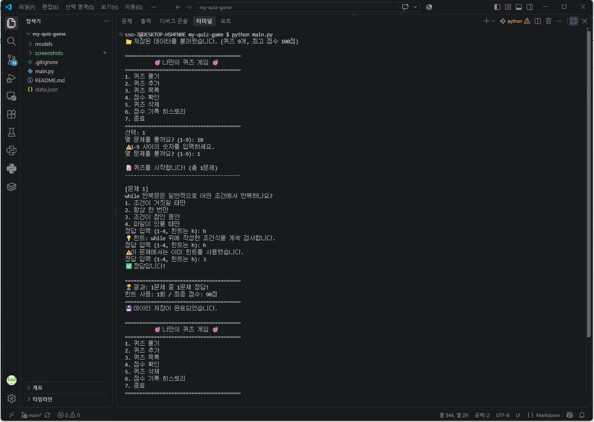

- `Quiz` 클래스에 `hint` 속성을 추가했습니다. 문제 풀이 중 `h`를 입력하면 힌트를 표시하고, 힌트를 사용한 문제마다 최종 점수에서 10점을 차감합니다. 한 문제에서 힌트는 한 번만 사용할 수 있습니다.
  - `_read_answer()`는 정답 번호와 힌트 사용 여부를 함께 반환합니다. `play_quiz()`는 힌트 사용 횟수를 누적한 다음 최종 점수에서 감점합니다. 감점 후 점수는 `max(0, 점수)`로 계산해 0점 미만이 되지 않도록 했습니다.

    <details>
    <summary><b>🔍 [참고] 상세설명 보기 (클릭하여 펼치기)</summary>

    - **Quiz 클래스 속성 확장**: `Quiz` 클래스 생성자(`__init__`) 및 `to_dict()` / `from_dict()`에 `hint` 속성을 추가하여 힌트 문구를 데이터화했습니다 [1].
    - **입력 분기 및 중복 방지**: 정답 입력 단계에서 `h` (대소문자 구분 없음) 입력 시 힌트를 표시하며, 한 문제당 힌트는 1회로 제한(`hint_used` 플래그 관리)하여 중복 감점을 방지합니다 [2].
    - **점수 계산 및 음수 방어 공식**:
      $$\text{기본 점수} = \text{round}\left(\frac{\text{정답 수}}{\text{푼 문제 수}} \times 100\right)$$
      $$\text{최종 점수} = \max(0, \text{기본 점수} - \text{힌트 사용 횟수} \times 10)$$
      *(※ 힌트 1회 사용당 10점 감점되며, `max(0, ...)` 처리를 통해 최종 점수가 음수로 떨어지지 않도록 방어합니다 [2].)*

    </details>

<br><br>

<a id="bonus-delete"></a>
## 9.4 퀴즈 삭제 기능

- **기능 개요**: 메인 메뉴 5번 항목에서 등록된 퀴즈를 조회하고 원하는 문제 번호를 선택해 삭제합니다 [2, 4].
- **주요 특징**: 퀴즈 삭제 시 즉시 `state.json` 파일에 반영되어 데이터 영속성을 유지합니다 [2, 4].

<br>

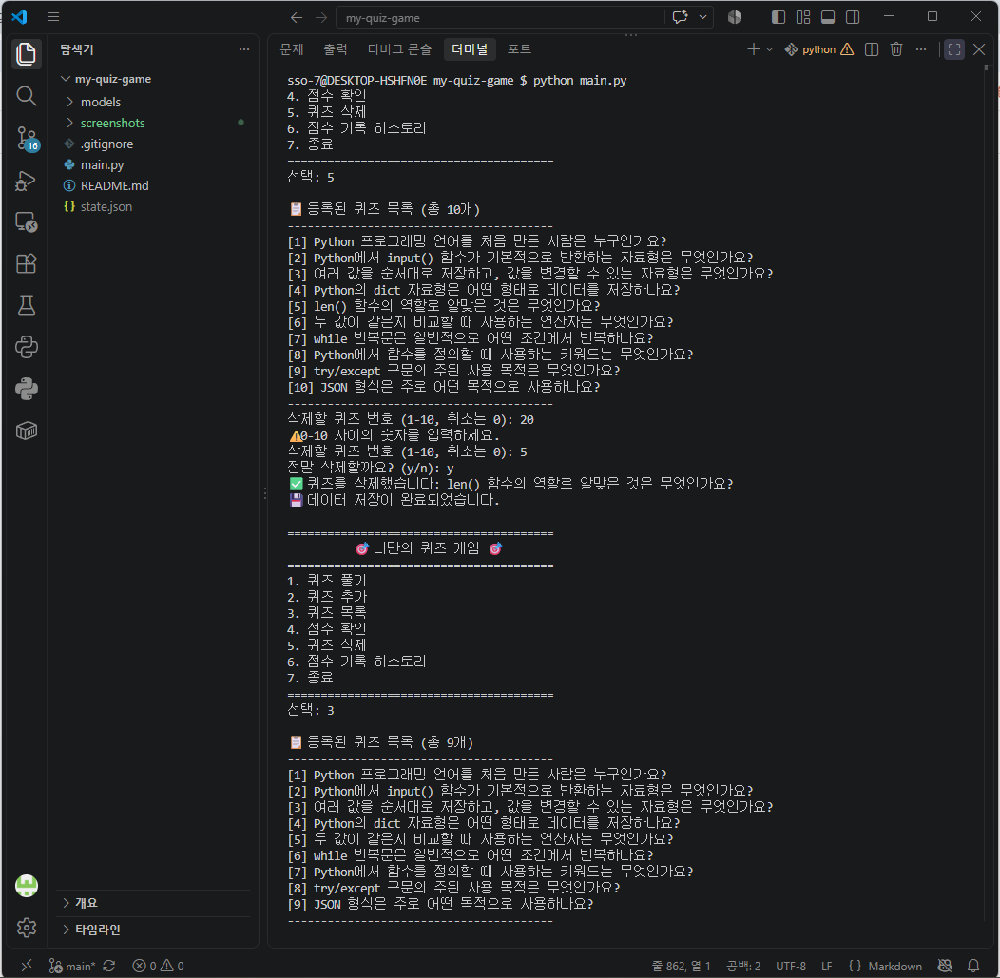


- 메인 메뉴의 `5`번에서 등록된 퀴즈를 삭제할 수 있습니다. 삭제 번호와 확인 입력을 받은 뒤 삭제하고, 변경 사항을 `state.json`에 저장합니다.
  - 삭제 번호에서 `0`을 입력하면 취소합니다. 실제 삭제 전 `y/n` 확인을 한 번 더 받습니다. `list.pop(index)`는 지정한 위치의 데이터를 리스트에서 제거하고 제거한 값을 반환합니다.

  <details>
  <summary><b>🔍 [참고] 상세설명 보기 (클릭하여 펼치기)</summary>

  - **안전 삭제 2차 확인**: 실수로 인한 퀴즈 삭제를 방지하기 위해 퀴즈 번호 선택 후 `정말 삭제할까요? (y/n)` 형태의 재확인 절차를 수행합니다.
  - **삭제 취소 옵션**: 퀴즈 번호 입력 시 `0`을 입력하면 데이터 삭제 과정이 취소되어 안전하게 메인 메뉴로 복귀합니다 .
  - **동적 파이썬 리스트 조작**: 선택한 번호 인덱스(`quiz_number - 1`)를 기반으로 `self.quizzes.pop()` 메서드를 호출하여 요소를 제거하고, `save_data()`를 통해 임시 파일 기반 안전 저장(Atomic Write)을 실행합니다.

  </details>

<br><br>

<a id="bonus-history"></a>
## 9.5 점수 기록 히스토리

- **기능 개요**: 단일 최고 점수뿐만 아니라 플레이한 모든 게임의 상세 실행 이력을 영구 보존 및 확인합니다.
- **주요 특징**: 메인 메뉴 6번 항목에서 날짜/시간별 플레이 실적을 역순(최신순)으로 한눈에 조회할 수 있습니다.

<br>

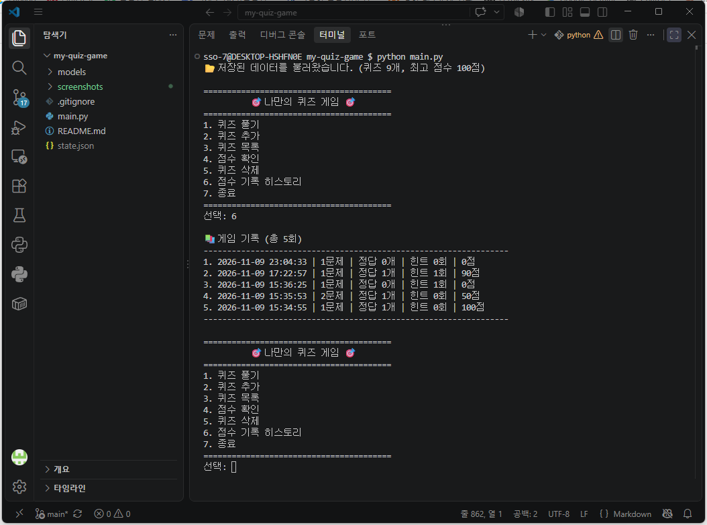

- 최고 점수 하나만 저장하지 않고 모든 게임 기록을 `history` 리스트에 저장합니다. 기록에는 날짜와 시간, 푼 문제 수, 정답 수, 힌트 사용 횟수, 최종 점수가 포함됩니다. 프로그램을 다시 실행해도 기록을 이어서 확인할 수 있습니다.
  - 기록은 게임 종료 시 `_record_game_result()`에서 딕셔너리로 만들어 리스트에 추가합니다. `save_data()`가 `history` 전체를 JSON에 기록하며, 다음 실행에서 `load_data()`가 다시 읽습니다. 게임 기록 메뉴는 최근 기록부터 화면에 출력합니다.

    <details>
    <summary><b>🔍 [참고] 상세설명 보기 (클릭하여 펼치기)</summary>

    - **히스토리 객체 구조**: 게임 1판을 완료할 때마다 아래 딕셔너리 구조를 생성하여 `self.history` 리스트에 누적합니다.
      ```json
      {
          "date": "2026-11-11 11:00:00",
          "question_count": 5,
          "correct_count": 4,
          "hint_count": 1,
          "score": 70
      }
    </details>

<br>

---